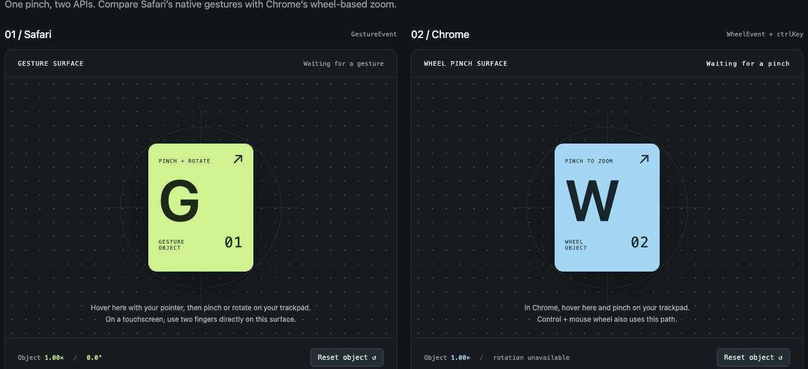

# Gesture lab: Safari vs Chrome

A dependency-free comparison of Safari GestureEvent and Chrome trackpad pinch
zoom implemented using wheel events with ctrlKey: true.

## Run

```sh
git clone https://github.com/amilajack/gesture-event-demo.git
cd gesture-event-demo
npm run prepare
npm start
```

Requires Node.js 24 or newer. No dependency installation is needed.



Open http://localhost:4177 in both Safari and Chrome. In Safari, pinch or rotate
over the left surface. In Chrome, pinch over the right surface. Control + mouse
wheel also exercises the right surface; ordinary scrolling does not zoom it.
Each column has independent reset and prevent-default controls. Both objects
scale around their centers and clamp zoom to 0.2–4×. This comparison targets
trackpad input; Chrome touchscreen pinch is not implemented by the wheel path.

| | Safari / GestureEvent | Chrome / WheelEvent |
| --- | --- | --- |
| Input | gesturestart, gesturechange, gestureend | wheel where ctrlKey is true |
| Scale | startZoom × event.scale | zoom × exp(−pixelDelta × sensitivity) |
| Rotation | event.rotation in degrees | Unavailable |
| Start/end | Explicit events | Idle inferred after 160 ms |
| Units | Scale ratio | Pixel / line / page deltas |
| Tuning | Browser provides scale | Demo sensitivity defaults to 0.010 |

Wheel line units use a demo convention of 16 px per line; page units use the
surface height. The sensitivity slider adjusts the delta-to-zoom conversion.
This does not promise identical browser zoom speed. ctrlKey cannot distinguish
trackpad pinch from Control + physical mouse wheel.

Listeners are non-passive so cancelable zoom events can be canceled. Unchecking
prevent-default allows page zoom alongside object zoom. Cancellation applies only
on the respective test surface. Ordinary wheel scrolling is allowed through.
The combined event stream keeps the latest 60 events, newest first. Clear log
resets event counters; reset object leaves the log intact.

Safari's non-standard API has feature detection and no wheel fallback. The trusted
input field distinguishes JavaScript-dispatched events. Browser automation input
can also be trusted, so Yes alone does not prove physical input.

The server binds to loopback and serves three allowlisted files. No dependencies
or install step are needed. Set PORT=4180 npm start to use another port.

Run npm run check for syntax and event-handler tests covering both paths,
cancellation, scroll passthrough, unit conversion, sensitivity, limits, reset,
idle handling, and bounded logging. Tests use a minimal DOM adapter and synthetic
events; physical trackpad behavior still needs a hands-on check.

The version-controlled pre-commit hook runs the same check as GitHub Actions.
`npm run prepare` installs it in a fresh clone.

References:
- https://developer.mozilla.org/en-US/docs/Web/API/GestureEvent
- https://developer.mozilla.org/en-US/docs/Web/API/Element/wheel_event
- https://developer.mozilla.org/en-US/docs/Web/API/MouseEvent/ctrlKey
